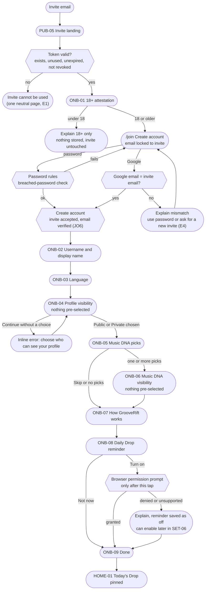

# J1. Invitation and onboarding

_Part of [Key journeys](README.md). Screens: PUB-05, PUB-06, PUB-02, ONB-01 to ONB-09, HOME-01. Wave α._

## Goal
An invited adult goes from an invitation email to today's Daily Drop in a few minutes. Along the way they make two honest visibility choices and pick a few pieces of Music DNA, and nobody pushes them anywhere.

## Preconditions
- An admin created an invitation (ADM-03). The invitation is email-bound, single-use and expiring (R-08, RECOMMENDED).
- The invitee is not signed in. Invitee opening the link while signed in: see edge case E3.

## Step order
The plan order is invite → 18+ → account → profile visibility → Music DNA → DNA visibility → notifications. The 18+ attestation comes **before** the account exists, so nothing is stored about someone who answers "no".

| Step | Screen | Required? | Notes |
|---|---|---|---|
| 1 | PUB-05 Invite landing | n/a | Token exchanged for an httpOnly cookie and redirected to `/join` (U-05). One sentence about GrooveRift and the alpha (SYS-05, link to PUB-12). |
| 2 | ONB-01 18+ attestation | Yes | One question with two equal answers: "I am 18 or older" and "I am under 18". No date of birth (OQ-10 recommendation). |
| 3 | `/join` Create account | Yes | Email is pre-filled from the invite and read-only. Choose **password** or **Google**. Password rules per D-054 as amended by D-061: at least 12 characters with an upper-case letter, a lower-case letter and a special character. One line under the field names what is missing and turns green when all rules are met (D-062; earlier, each rule was ticked; was: at least 15 characters, a counter while typing, breached-password check (HIBP, fail-open). Links to Terms and Privacy (PUB-10). |
| 4 | ONB-02 Username and display name | Yes | Live availability check, rules shown before typing (WCAG 3.3.2). Suggestions when taken (3.3.3). |
| 5 | ONB-03 Language | Yes, pre-filled | Interface language pre-selected from the invite's language or the browser. Discovery languages are optional. The language switcher is on every onboarding screen. |
| 6 | ONB-04 Profile visibility | Yes (D-034) | Neutral active choice (D-025, D-030). Option text per IA §7 "Consequence for onboarding copy". |
| 7 | ONB-05 Music DNA picks | No (visible Skip) | Genres first, then artist typeahead. Soft target "about 5–10". One sentence on what the picks affect and that they can be changed later. |
| 8 | ONB-06 Music DNA visibility | Yes, if shown (D-034) | Neutral active choice (D-024, D-030). **Shown only if step 7 added at least one item** (D-034); otherwise the choice is asked the first time DNA is added (J2). |
| 9 | ONB-07 How GrooveRift works | No | Daily Drop and compatibility in two or three sentences each. |
| 10 | ONB-08 Daily Drop reminder | No | Opt-in. Behind a feature flag if push is not in the alpha (OQ-08). |
| 11 | ONB-09 Done | n/a | Lands on HOME-01 with today's Drop pinned at the top. |

Progress is shown as "Step 3 of 9" text plus a bar. Optional steps that are skipped still count, so the total does not jump around. Back is always available and keeps earlier answers.

## Flow

## Visibility checks
| Moment | Rule | Source |
|---|---|---|
| Account created, onboarding not finished | The profile is **not visible to anyone** and not searchable. It has no username before step 4. | RECOMMENDED |
| Visibility not chosen yet (member left during step 6) | Treated as **private and not discoverable**. | GDPR Art. 25(2), `ux-foundations.md` §3.4 |
| Music DNA added but visibility not chosen | Treated as **only me** until the member chooses. | GDPR Art. 25(2) |
| "Public" option text | All members can see the profile, Music DNA and Daily Drop answer history; follower lists are visible to followers. Public profiles can appear in Discover and compatibility. | D-030, D-032, D-033 |
| "Private" option text | Only approved followers see the profile sections. Daily Drop answers stay visible to all members on the question page. Replies in public threads are visible to everyone in that thread. | D-020, D-021 |
| Signed-out visitors | Never see anything from onboarding. Public profiles show only the minimal PUB-08 view once onboarding is done. | D-022, PUB-08 |

## Edge cases and errors
| # | Situation | Behaviour |
|---|---|---|
| E1 | Invite token unknown, used, expired or revoked | One neutral page: "This invitation can't be used. Ask the person who invited you for a new one." It does not say which reason applies, because a used token in someone else's hands should not confirm that an account exists. |
| E2 | Invite accepted twice at the same time (two tabs) | The server accepts the invite once. The second attempt sees E1, or the existing session if it is the same browser. |
| E3 | Invite opened while signed in | If it is the same email: "You already have an account" and a link Home. If another account is signed in: "Sign out to accept this invitation". Nothing is consumed. |
| E4 | Google account email differs from the invite email | Explain that the invite belongs to one email address and offer password sign-up with that address. Linking another email needs a new invite. This prevents forwarded invites (R-08). |
| E5 | Under 18 selected | Short, kind page: GrooveRift is for adults, link to the guidelines. No account, no data stored, nothing recorded about the answer. If the person goes back and changes the answer, this is a self-declaration and can't be verified; counsel to confirm the approach (OQ-10). |
| E6 | Username taken, reserved (staff, brand, recently released handle per OQ-15) or not allowed | Same message for all three: "This username isn't available", with two or three suggestions. Reserved and taken are not distinguished. |
| E7 | Username impersonates a verified artist or a known person | Allowed at sign-up (no automated identity checks), handled by the impersonation report category (J5). Display name rules are the same. |
| E8 | Member closes the browser mid-onboarding | On next sign-in, onboarding resumes at the first unfinished **required** step. Optional steps already passed are not repeated. Until the required steps are done, every app route redirects to onboarding. |
| E9 | Network error on any step | The step keeps its input and shows Retry (JR4). Choices already saved on the server are not lost. |
| E10 | Music DNA catalog search fails or returns nothing | "Can't search right now" with Retry, and the genre chips still work. Missing artists: "Not finding someone? You can add more later." Catalog suggestions come in B5. |
| E11 | Push permission denied, or iPhone not installed to the Home Screen | Denied: the reminder is saved as off, with a short explanation of how to enable it in the browser. iPhone Safari without installation: explain that reminders need "Add to Home Screen" (iOS 16.4+), and offer a link to instructions. |
| E12 | Time zone detection fails or looks wrong | The reminder screen shows the detected zone in words ("Zagreb time") with a change link. Times are stored with an IANA zone. |
| E13 | Member chose a language different from the invite | All later screens and emails switch immediately. The invite language is only the starting suggestion. |
| E14 | Member leaves step 6 (visibility) open for a long time | No timeout that loses the choice. The session follows the normal session lifetime. |

## Accessibility notes
- Each step is its own page with an `h1`. Focus moves to the heading when the step changes (JR5).
- The visibility choices are a native radio group with nothing checked. The Continue button stays enabled; pressing it without a choice shows an inline error linked to the group ("Choose who can see your profile"). It is not disabled, because disabled buttons don't explain themselves.
- Genre and artist chips are toggle buttons with `aria-pressed` and a visible "selected" mark that does not rely on colour.
- Password field allows paste and password managers; `autocomplete` values set (WCAG 3.3.8, 1.3.5).

## Open items
- Resolved: visibility steps are required (D-034).
- JO6: invite acceptance counts as email verification (RECOMMENDED, depends on R-08).
- OQ-08: whether ONB-08 is in the alpha.
- OQ-10: counsel review of the 18+ attestation.
