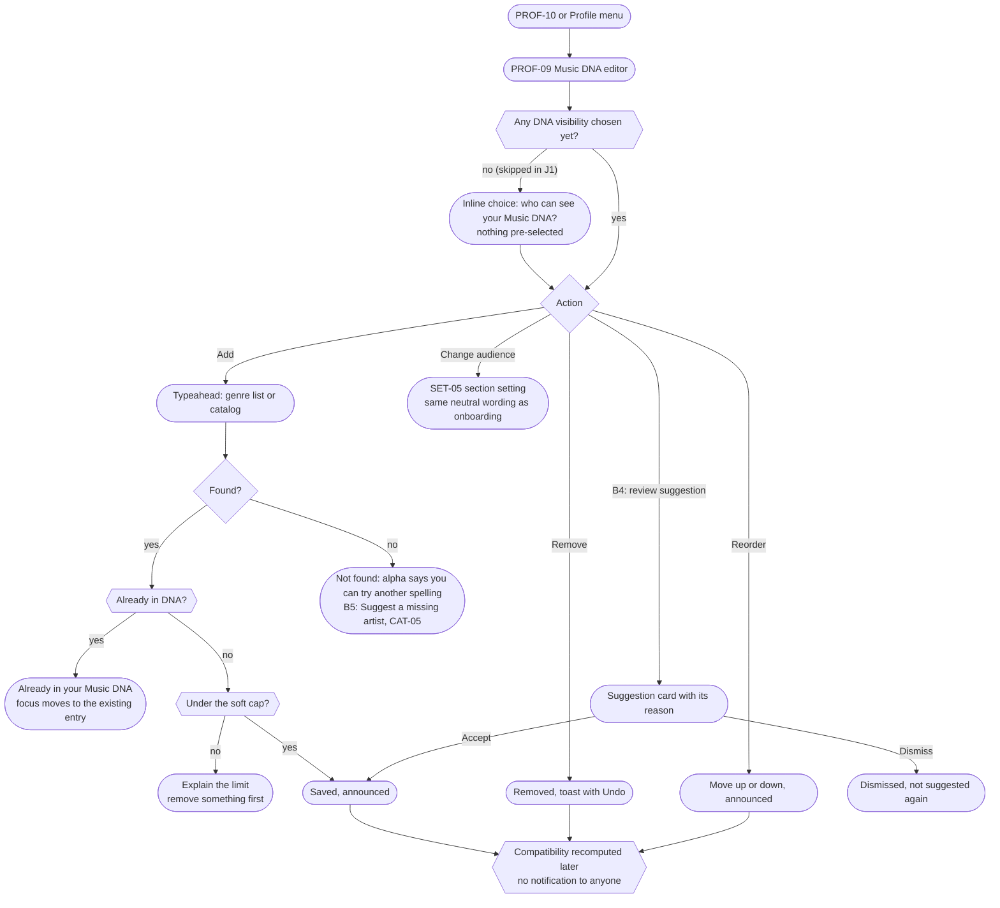

# J2. Music DNA editing

_Part of [Key journeys](README.md). Screens: PROF-09, PROF-04, PROF-10, SET-05, CAT-01, CAT-05 (B5). Wave α; suggestions B4._

## Goal
A member keeps their Music DNA honest: they add, remove and reorder genres and artists whenever they like, and they always know who can see each section. Nothing changes their Music DNA without their confirmation (§4).

## Entry points
- Own profile (PROF-10) → Music DNA section → "Edit".
- Profile menu → Music DNA (`/me/dna`).
- Empty state on their own PROF-04: "Add artists".
- B4: Discover empty state "Add a few artists to get suggestions" (DISC-01).

## Screen model (PROF-09)
- Sections: **Genres** and **Artists** (RECOMMENDED for the alpha; releases are a later option per the domain model). Each section shows its audience in words, for example "Visible to: all members", with a "Change" link to the matching SET-05 setting.
- Each entry: name, disambiguation for artists ("Low, US slowcore band"), position, a Remove button, and Move up / Move down buttons. Drag to reorder is an extra, never the only way (WCAG 2.5.7).
- Add: one search field per section. Genres come from the curated genre list; artists from the catalog typeahead.
- Changes save per action (no global Save button), each confirmed by a live-region message ("Added Radiohead").

## Flow

## Visibility checks
| Moment | Rule | Source |
|---|---|---|
| Who sees each section | Per-section setting: all members · followers · Mutuals · only me. A private profile caps it at followers. Never signed-out visitors. | D-024, matrix §2 |
| First DNA added after skipping in onboarding | An inline choice appears before the first item is saved. Until answered, the section is **only me**. | J1, GDPR Art. 25(2) |
| Narrowing the audience | Takes effect immediately for profile views, search and Discover. Compatibility reasons shown to others stop citing hidden items at the next render (U-12). | U-12 |
| Blocked viewers | Never see any section (SYS-01). | D-019 |
| Moderators | Only through a case, logged. | matrix 📄 |
| Suggestions (B4) | The reason shown to the owner may mention their own activity only, never another member's private data. | §4, U-12 |

## Edge cases and errors
| # | Situation | Behaviour |
|---|---|---|
| E1 | Save fails (network) | The change is shown as not saved with Retry. Optimistic UI only for reorder, which rolls back visibly on failure. |
| E2 | Offline | Editor is read-only with a banner (IA §6.1 O). |
| E3 | Two devices edit at once | Each add or remove is its own operation, so both apply. A reorder based on an outdated list is rejected and the editor reloads the current order with a message. |
| E4 | Catalog merge (two artist entries become one) | The entry follows the redirect automatically (domain invariant 5). If both merged artists were in the DNA, they collapse into one entry at the higher position, and the member is told once. |
| E5 | Artist no longer available from the source | The entry stays, labeled "No longer available from the source" (§10). The member may remove it. |
| E6 | Removing the last item | Allowed. The section's audience setting stays as it was. Profile shows the section as omitted for others and "Add artists" for self. |
| E7 | Soft cap | RECOMMENDED around 50 artists and 20 genres, so Music DNA stays a portrait rather than a library export. Value tunable; exact numbers set in Phase 4. |
| E8 | Disambiguation | Typeahead always shows the disambiguation for artists with the same name. Without it, members pick the wrong artist and compatibility reasons become nonsense. |
| E9 | Suggestion accepted by mistake (B4) | The new entry has a normal Remove with Undo. Its source is recorded as `accepted_suggestion`. |
| E10 | Explicit entries | Never modified, reordered or removed by the system (§4, domain invariant 3). |
| E11 | Changing DNA during an open profile view by someone else | The viewer sees the change on their next load. There is no live update and no notification. |

## Accessibility notes
- Move up and Move down are buttons with names that include the item ("Move Radiohead up"). After a move, focus stays on the moved item.
- Remove has Undo in a toast that stays at least 5 seconds and is reachable by keyboard; the toast never hides the focused element (WCAG 2.4.11).
- The audience line is plain text next to the section heading, not only an icon.

## Open items
- Section list beyond genres and artists (for example albums): DEFERRED unless the owner wants it in the alpha.
- Soft-cap values (E7): RECOMMENDED, set in Phase 4.
