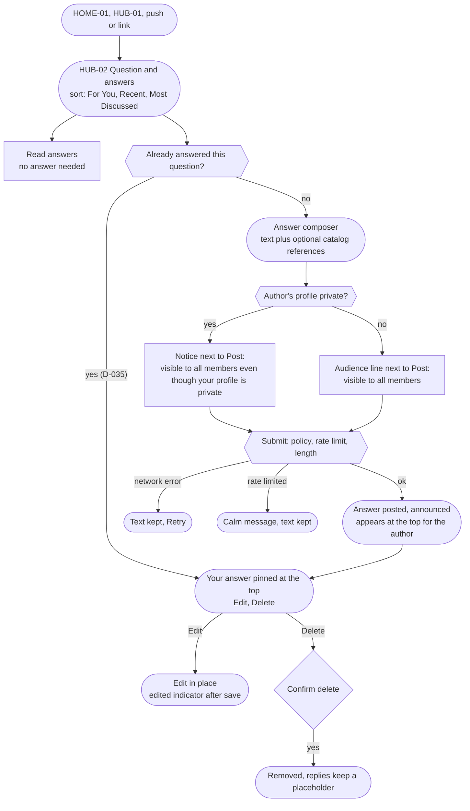
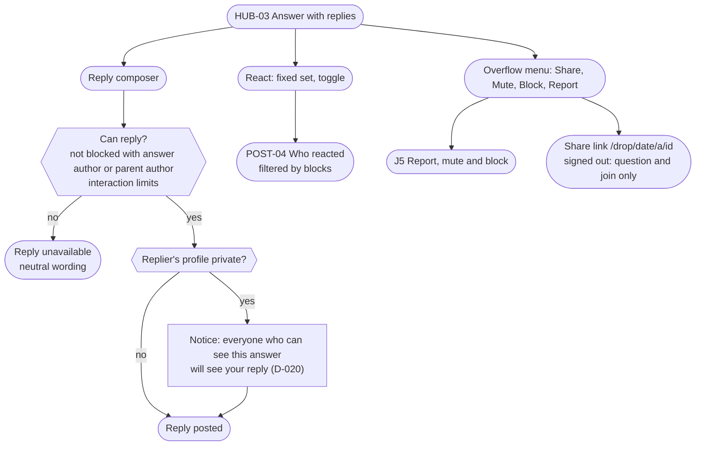
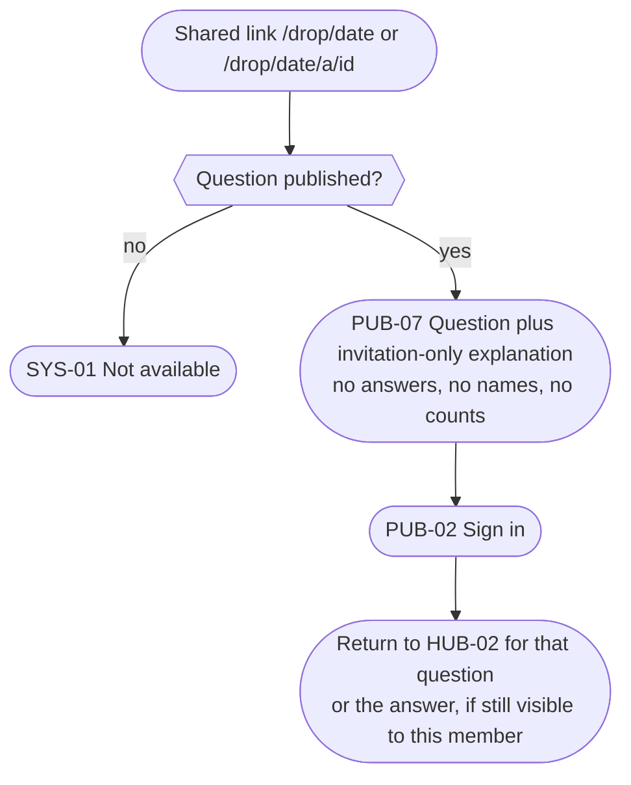
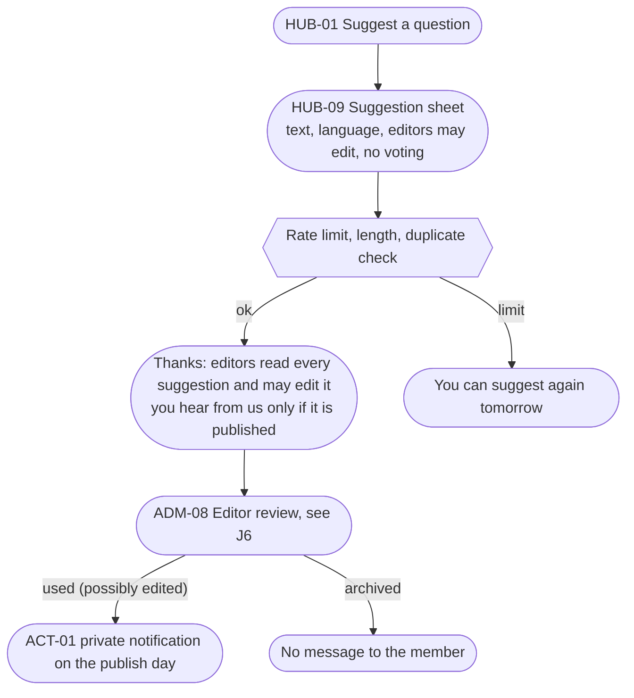

# J3. Daily Drop

_Part of [Key journeys](README.md). Screens: HOME-01, HUB-01 to HUB-04, HUB-09 (B2), PUB-07, POST-04, SAFE-01, SET-06, SYS-01. Wave α._

## Goal
Every day at 00:00 UTC one question appears worldwide. A member can read it and the answers without answering (P2). If they answer, they know who will see the answer before they post (P4, D-021). Replies and reactions turn answers into conversations. Every past question stays in the archive.

## Entry points
| Entry | Lands on | Notes |
|---|---|---|
| Opening the app | HOME-01, today's Drop pinned at the top | IA1 |
| Hub tab | HUB-01 → HUB-02 | |
| Daily Drop reminder (push, opt-in) | HUB-02 for the question named in the push | OQ-11 rule: the push names the latest published question the member hasn't been notified about. The body contains only the question, never member content. |
| Notification about a reply or reaction | HUB-03 scrolled to the reply | Re-authorized on open (JR1). |
| Share link, signed out | PUB-07: question and an invitation to join | D-022 |
| Share link, signed in | HUB-02 | |
| Archive | HUB-04 → HUB-02 for that date | |
| Profile Daily Drop history | PROF-03 → HUB-03 | Visibility per D-032. |

## Flow: read and answer

## Flow: replies, reactions and safety

## Flow: signed-out share (D-022)

## Visibility checks
| Moment | Rule | Source |
|---|---|---|
| Question | Visible to everyone once published, including signed-out visitors and blocked pairs. Unpublished dates are SYS-01. | matrix, U-03 |
| Answers | Visible to all signed-in members, including answers by private members. | D-021 |
| Blocked pair | Each side's answers and replies are hidden from the other. In shared threads, other members see the reply; the blocked pair sees a placeholder ("Reply not available"). | D-019, IA §6.1 B |
| Signed-out | Question and join invitation only; Open Graph carries the question only. Answer links show the same view, with no hint about the answer's author. | D-022, U-08 |
| Counts and Most Discussed | Count only member-visible content. Hidden or removed content does not count. | D-021 counts rule, U-13 |
| Profile history | The list on PROF-03 follows D-032; the individual answer stays visible on the question page. | D-032 |
| Push body | Question text only. No answer text or names. | U-14 |
| Muted members | Their answers are collapsed for the muter ("Answer from someone you muted", tap to show). They are not told. | SAFE-03, RECOMMENDED |

## Archive and older questions (D-036)
- HUB-04 lists published questions by month, with "Jump to date". Unpublished dates never appear.
- A past question opens HUB-02 for that date and is fully interactive (§5 "fully interactive archive").
- **CONFIRMED (D-036):** answers to older questions are allowed. Every answer shows its date in a neutral way ("12 Nov"), and the Recent sort puts new answers at the top. There is no special "late" badge, because `ux-foundations.md` §3.2 rejects lateness labels as pressure. This replaces "labeled late" in OQ-12 and HUB-03.

## Question suggestions (B2, D-037)

- Suggestions are never public and never voted on (§5).
- If a suggestion is used, the published question is editorial content. Whether the submitter gets public credit is **not** in scope; it would need owner approval.

## Edge cases and errors
| # | Situation | Behaviour |
|---|---|---|
| E1 | Member opens HUB-02 just before 00:00 UTC and answers just after | The answer belongs to the question that was on screen (the composer carries the question ID). A small banner offers "A new Daily Drop is out". The page never swaps the question under the member's cursor (WCAG 3.2.2). |
| E2 | Today's question failed to publish and the reserve also failed | HUB-01 and HOME-01 show "Today's question is on its way" and yesterday's Drop, labeled with its date. No empty day, no error code (IA §6.2). Staff are alerted (J6). |
| E3 | New answers arrive while reading | A "New answers" button appears; nothing is inserted above the reading position (WCAG 2.2.2). |
| E4 | Member already answered (D-035) | The composer is replaced by their answer with Edit. Trying to post again (two tabs) returns "You've already answered; edit your answer instead" and keeps the text. |
| E5 | Answer deleted that has replies | A placeholder "Answer deleted" keeps the replies readable (§3 deletion, minimal placeholders). |
| E6 | Answer removed by moderation | Hidden for everyone except staff on the case. The author gets SAFE-05 with the statement of reasons (R-07). Replies keep a placeholder. |
| E7 | Author blocks a replier, or the reverse, after replies exist | Replies stay for others; the pair sees placeholders for each other (D-019). New replies between the pair are not possible. |
| E8 | Private member switches to public after answering | No change: answers were already visible to all members. Only PROF-03 changes. |
| E9 | Catalog reference later merged or unavailable | References resolve through redirects; unavailable items show "No longer available from the source". |
| E10 | Offline | The question is readable from cache (U-11, last viewed only); answers need the network; the composer keeps text in memory with Post disabled. |
| E11 | Push arrives for a question the member already answered | Opens HUB-02 normally. No "you answered already" message, no streak. |
| E12 | Reminder time is before the UTC publication in the member's zone (east of UTC) | OQ-11 rule: the push is about the latest published question not yet notified, so a member in Zagreb with a 00:30 reminder gets the question published at 01:00 local the previous day, unless they were already notified about it. Copy shows the local release time ("New question every day at 01:00 your time", adjusting for daylight saving). |
| E13 | Share link to an answer whose author later blocked the signed-in viewer | SYS-01 for that answer; the question page itself still opens. |
| E14 | Very long answer | Collapsed after a few lines with "Read more" (button, not a link to a new page). Length limit set in Phase 4. |
| E15 | Answer in a language other than the interface | Shown as written. Optional language field per `ux-foundations.md` §4.3 (OPEN). |

## Accessibility notes
- The question is the page's `h1`. The answer list is a list; each answer is an `article` with the author and date in its heading.
- Sort control is a native select or radio group, not a custom dropdown.
- Reactions are toggle buttons whose accessible name includes the reaction and count ("Fire, 3 reactions, you reacted").
- The private-member notice is plain text tied to the Post button with `aria-describedby`, so screen readers hear it before posting.

## Open items
- Resolved: one answer per question (D-035), archive open with neutral dates (D-036), suggestion notification only if published (D-037).
- OQ-13 reaction set.
- Mute behaviour in answer lists (collapsed with "show"): RECOMMENDED.
