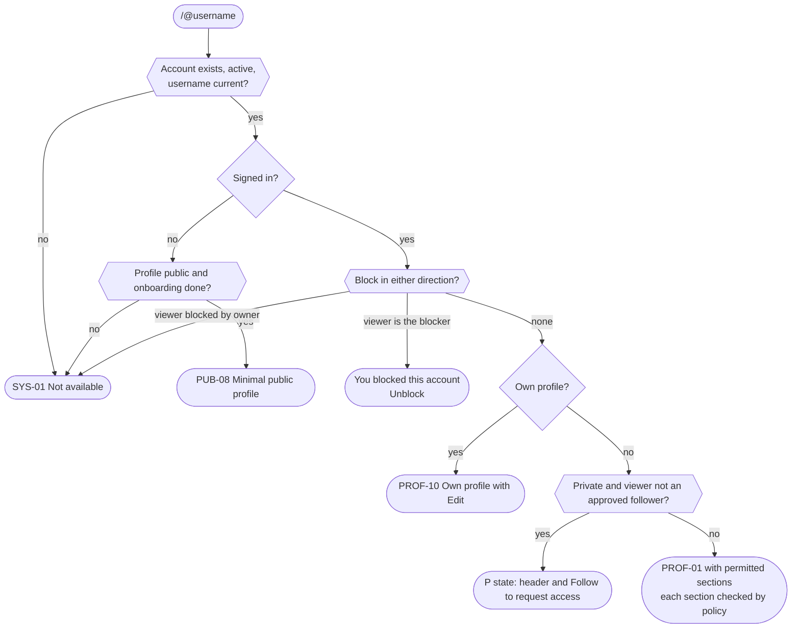
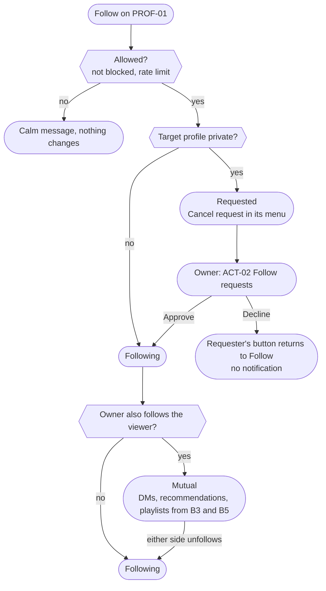
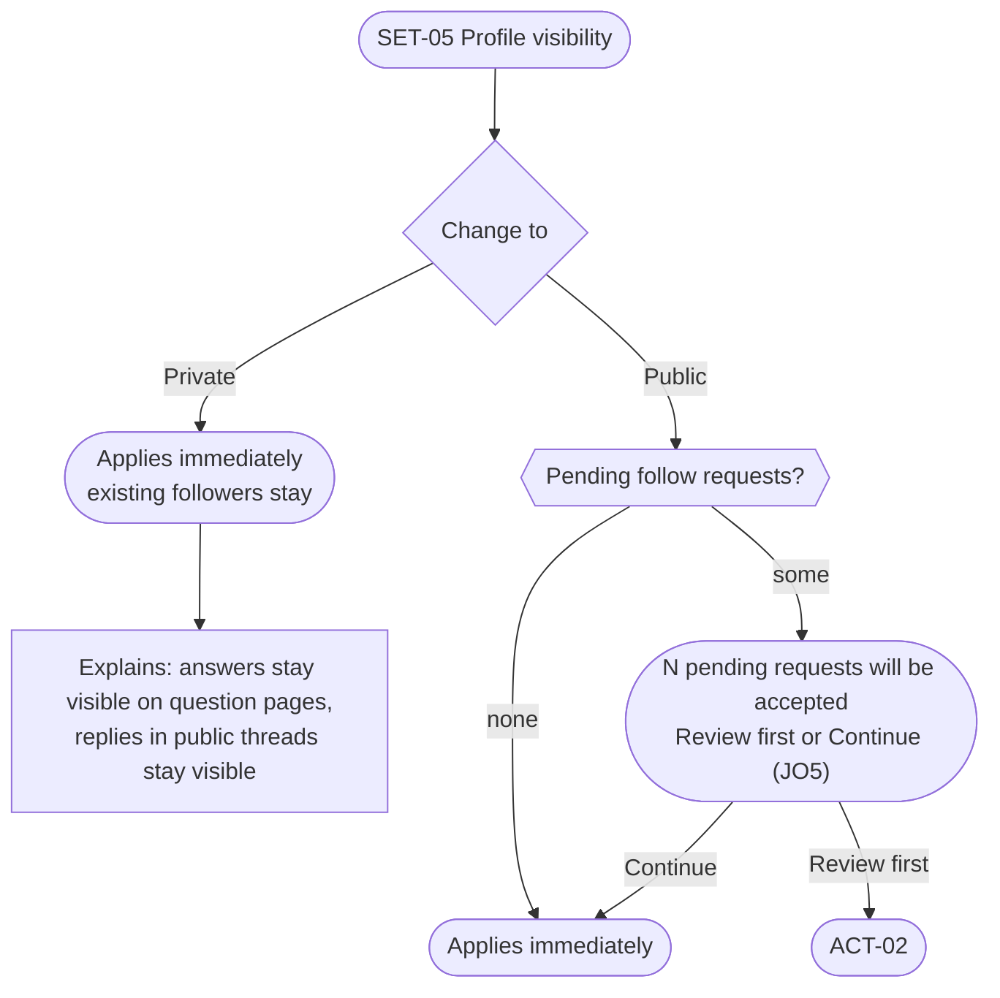

# J4. Profile states and following

_Part of [Key journeys](README.md). Screens: PROF-01, PROF-03, PROF-04, PROF-07, PROF-10, PUB-08, ACT-01, ACT-02, SET-05, SAFE-02, SYS-01. Wave α._

## Goal
Anyone opening a profile sees exactly what the owner allowed, and nothing in the page reveals what is hidden or why. Following works in one tap for public profiles and through a request for private ones. Mutuals appear when both follow each other (D-013).

## What each viewer sees
`⚙️` = per-section setting (defaults: Music DNA all members, D-024; Daily Drop history same as profile, D-032; lists and counts followers, D-033). Hidden sections are **omitted**, not shown locked (PROF-01).

| Viewer | Public profile | Private profile |
|---|---|---|
| Self | Everything, plus Edit and audience labels on each section ("Visible to: followers") | Same |
| Mutual | Header, posts (B1), ⚙️ sections, Message (B3) | Same as public |
| Follower | Header, posts (B1), ⚙️ sections | Same as public |
| Member, not following | Header, posts (B1), ⚙️ sections set to "all members" | **P state:** header plus "This account is private. Follow to request access." |
| Blocked, either direction | Blocker: "You blocked this account" + Unblock. Blocked side: SYS-01 | Same |
| Signed out | PUB-08 minimal: username, display name, avatar, bio | SYS-01 |
| Deactivated, suspended, banned, deleted | SYS-01 for everyone except staff on a case | Same |

The overflow menu (⋯) is the same for every visible profile: Share (public profiles only), Mute, Block, Report (IA10).

## Flow: viewing a profile

## Flow: following

## Flow: changing profile visibility (SET-05)

No confirmation dialog is added for choosing Private. Both directions are equally easy (D-030, P3).

## Visibility checks
| Moment | Rule | Source |
|---|---|---|
| Counts on the profile | Shown only to viewers who can see the list. A viewer who cannot see the list sees no number. | D-033, U-13 |
| Daily Drop history | Follows the PROF-03 setting; the individual answers on question pages stay visible (D-021). | D-032 |
| "How you match" (B4) | Cites only items the viewer may see. | U-12 |
| Old username | No redirect. The old handle shows SYS-01 during its reservation period. | U-04 |
| Private profile, signed-out visitor | SYS-01, the same as a non-existent profile. | U-02 |
| Requested state | Only the requester and the owner know about a pending request. The owner's lists never include pending followers. | RECOMMENDED |
| Blocker's view | The blocker sees their own block state so they can undo it. The blocked side cannot tell (D-019). | D-019 |

## Edge cases and errors
| # | Situation | Behaviour |
|---|---|---|
| E1 | A follow request is pending and the owner blocks the requester | The request disappears. The requester sees SYS-01 on the profile from now on. |
| E2 | Viewer is a follower and the owner removes them | Needs a **Remove follower** action (JO1, OPEN). Without it, the owner's only option is Block. If approved: no notification; the viewer drops back to the non-follower view. |
| E3 | Owner switches from private to public | See flow above. Pending requests are accepted after the member sees the count (JO5). |
| E4 | Owner switches from public to private | Followers stay. Non-followers see the P state from their next load. Cached profile pages are personalized and never shared-cached (D-016). |
| E5 | Requester cancels a request | The request disappears from ACT-02. |
| E6 | Repeated request after a decline | Allowed, but rate-limited per pair to stop pestering (RECOMMENDED: one new request per pair per 7 days). |
| E7 | Mutual ends (either unfollows) | Message button disappears. Existing DM history stays readable to both, but new messages need a Mutual again (B3; exact rule OPEN for B3). Playlist contributions: OPEN in the domain model. |
| E8 | Profile has no posts or answers | Neutral text. No "inactive" label (§3). |
| E9 | Notification about a new follower whose profile later becomes unavailable | The notification renders without that person's details or is removed (JR1). |
| E10 | Username changed while someone has the page open | Their next navigation uses the old URL and gets SYS-01; links inside the app use IDs and keep working. |
| E11 | Very long display name or bio, Croatian diacritics | Wraps at 320 px without clipping (WCAG 1.4.10). |

## Accessibility notes
- The relationship button names its current state ("Following", "Requested", "Mutual"). Unfollow and Cancel request are separate, labelled actions, never a hidden second tap.
- The private state is text, not only a lock icon.
- Section audience labels for the owner are text ("Visible to: followers").

## Open items
- JO1: Remove follower (OPEN, scope addition).
- JO5: accept pending requests on switch to public (RECOMMENDED).
- E6 rate limit value (RECOMMENDED).
- E7 Mutual ends: DM and playlist rules (OPEN, B3/B5).
