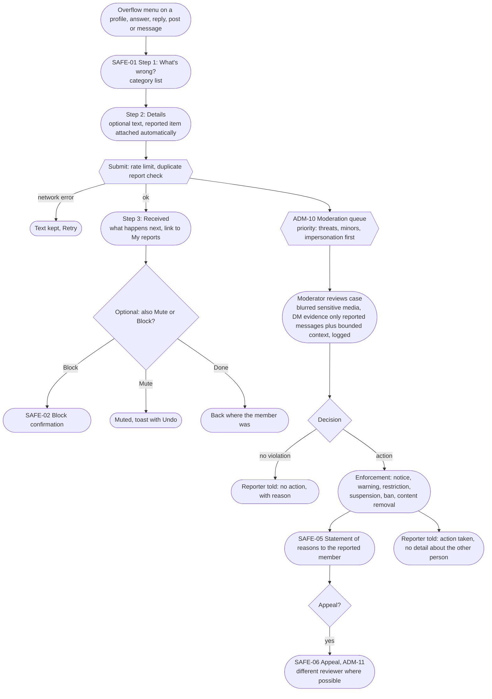
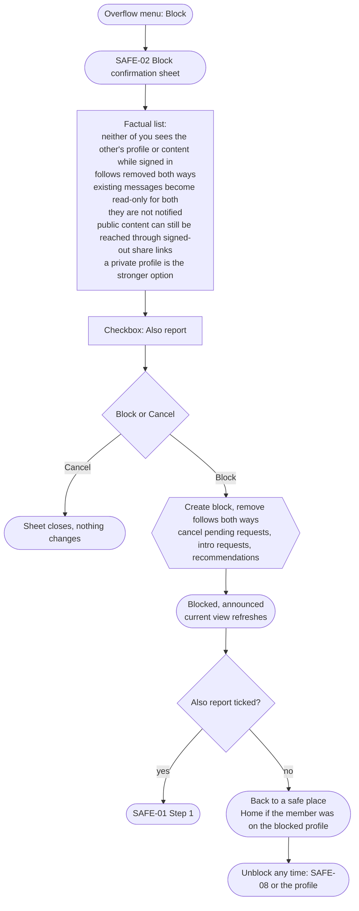

# J5. Report, mute and block

_Part of [Key journeys](README.md). Screens: SAFE-01 to SAFE-08, ADM-10, ADM-11, MSG-02 (B3), ACT-01, SYS-01. Wave α._

## Goal
A member can quiet, cut off or report someone in two or three taps from any profile or piece of content (IA10, P5). Each tool does exactly what it says. The victim is never punished: nothing tells the other person, and the member keeps control of their own content.

Three tiers (`ux-foundations.md` §3.3):
| Tool | Who notices | Effect |
|---|---|---|
| **Mute** (SAFE-03) | Nobody | One-way. The muted person's content is hidden or collapsed for the muter. Nothing else changes. |
| **Block** (SAFE-02) | Nobody is notified, but the blocked person may notice that the profile is gone | Two-way hiding while signed in (D-019). Follows removed both ways. No new interactions of any kind. DMs read-only for both (D-023). |
| **Report** (SAFE-01) | Moderators only. The reported member never learns who reported. | Human review, statement of reasons on any action (R-07), appeal. |

## Flow: report

**Categories (working list, final names in 3.8):** harassment or bullying; hate; threats or violence; sexual content; someone under 18 (`minor`); impersonation; spam or scams; copyright (B6 workflow; alpha routes to the notice form); AI-generated content presented as real; private information shared without consent; something else. Illegal content can also be reported by non-members through PUB-11 (counsel B.5).

## Flow: block

## Flow: unblock
- From SAFE-08 or from the blocker's view of the profile ("You blocked this account").
- The sheet says follows are **not** restored and that the other person can now see the member's content again, depending on visibility settings.
- Re-blocking the same person is possible immediately. There is no cooldown, because blocking must never be delayed.

## Visibility checks
| Moment | Rule | Source |
|---|---|---|
| Blocked side opens profile, post, answer or message link | SYS-01, identical to a deleted account. | D-019, IA8 |
| Shared threads | Other members see both people's content. The pair sees placeholders for each other. | D-019 |
| Search, Discover, compatibility, mentions, notifications | The pair is removed from each other's results, suggestions and autocomplete. Notifications from before the block are removed or rendered without details. | D-019, JR1 |
| DMs (B3) | History read-only for both; each can delete their own side; messages stay reportable. | D-023 |
| Reports | The reported member never learns who reported. Reporters see the status of their own reports only (SAFE-04). | matrix, §12 |
| Moderator access | Only through a case. Opening DM evidence needs step-up re-authentication and a stated reason, both logged (`EvidenceAccess`). | IA §2.11, matrix 📄 |
| Statement of reasons | Says what rule, what content and what action, without revealing the reporter or detection internals. | R-07, §12 |

## Edge cases and errors
| # | Situation | Behaviour |
|---|---|---|
| E1 | Member blocks someone who is a Mutual with an open conversation | Conversation becomes read-only for both (D-023), marked as such in MSG-01. |
| E2 | Member reports an old message from a blocked person | Allowed. Reporting stays possible after a block (D-023). |
| E3 | Member blocks a staff member personally | Allowed. Moderation notices and system messages still arrive, because they come from GrooveRift, not from that person. A moderator who is blocked by a member should not decide that member's cases (conflict-of-interest rule, RECOMMENDED). |
| E4 | Same item reported many times | Grouped into one case; each reporter still gets status updates. |
| E5 | Report abuse (mass false reports) | Rate limit on reports per member; repeated bad-faith reports are a guidelines issue handled by moderators, never automatic penalties. |
| E6 | Report about someone under 18 | Highest priority category. Moderator guidance in Phase 4 policy work (OQ-10). |
| E7 | Impersonation report | Priority queue, evidence-based review (§12). The reporter may be asked for proof through a private channel; nothing is shown publicly. |
| E8 | Reporter's account is deleted before the decision | The case continues; the outcome notice is not sent. |
| E9 | Reported content deleted by its author before review | The case keeps a moderation copy under the retention policy (GDPR review); the member-facing item is gone. |
| E10 | Block while a reply is being typed in a shared thread | Submitting returns "You can't reply here" and keeps the text so the member can copy it. |
| E11 | Mute undo missed | Unmute from SAFE-08 or the profile menu. |
| E12 | Moderation team unavailable (small team, OQ-06) | Reports are still accepted; SAFE-04 shows "Received". The alpha notice (PUB-12) states expected response times honestly. |
| E13 | Member has blocked many accounts | SAFE-08 is a searchable list. No limit on the number of blocks. |

## Accessibility notes
- Report and block sheets trap focus and return it to the overflow button on close (WCAG 2.4.3).
- Category list is a radio group with a short description per category.
- Block facts are a real list, not a paragraph, so screen readers can step through them.
- Confirmation messages ("Blocked", "Report received") use a live region.

## Open items
- E3 conflict-of-interest rule (RECOMMENDED).
- Report categories: final names in 3.8; category list RECOMMENDED here.
- OQ-06 moderation staffing; OQ-10 minors.
