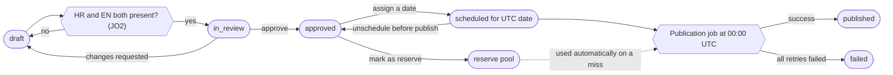
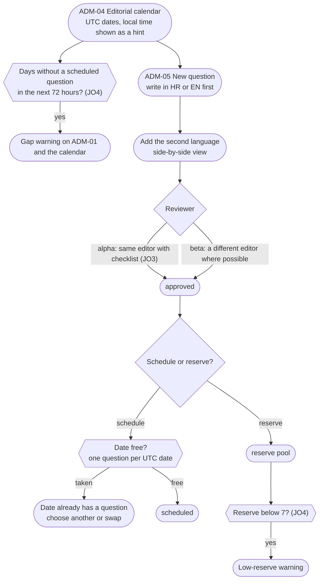
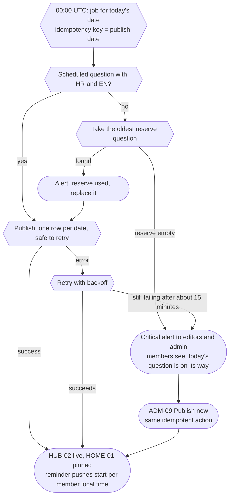

# J6. Admin editorial

_Part of [Key journeys](README.md). Screens: ADM-01, ADM-04, ADM-05, ADM-08 (B2), ADM-09, ADM-17, ADM-18, HUB-01, HUB-02. Wave α; Weekly Poll and Did You Know? in B2._

## Goal
There is a Daily Drop question at 00:00 UTC every day, in Croatian and English, reviewed and never duplicated (§5, §6). Editors see gaps days ahead, the reserve covers any miss automatically, and staff hear about failures before members notice.

## Roles
- **Editor:** drafts, translates, reviews, schedules, manages the reserve.
- **Admin:** everything an editor does, plus alert settings and feature flags (ADM-17).
- Moderators have no editorial access (matrix "Editorial and staff-only").
- All staff sign in with strong authentication (PUB-03). Editorial routes are role-checked, never cached and `noindex` (U-15).

## Question lifecycle
States from the domain model: `draft` → `in_review` → `approved` → `scheduled` → `published`, plus `failed`. Reserve questions are `approved` with `is_reserve = true`.

## Flow: planning and scheduling

## Flow: publication at 00:00 UTC

## Flow: suggestions (B2)
- ADM-08 lists member suggestions, newest first, with the language and the submitter visible to editors only.
- Actions: **Turn into draft** (copies the text into ADM-05; the editor rewrites freely), **Archive** (no message to the member).
- When a question made from a suggestion is published, the submitter gets a private notification (D-037). Archiving sends nothing. The link between suggestion and question is kept for this purpose only.
- Suggestions never publish themselves and are never voted on (§5).

## Weekly Poll and Did You Know? (B2)
The same lifecycle and calendar, with these differences:
- **Weekly Poll:** one per ISO week, publication weekday flexible; options in both languages; results after voting or close. No reserve and no push (§6).
- **Did You Know?:** two per week. Public sources are required where available, plus a certainty qualifier for disputed claims. **Fact-check notes** are visible to editors and admins only and never reach member APIs (matrix). No push (§6).
- A missed Weekly Poll or Did You Know? produces a calendar warning, not a member-facing placeholder.

## Corrections after publishing
> **Decided in D-101 (2):** a published question is never edited, not even for a typo; for a severe error an admin withdraws it. The two bullets below on typo fixes and editor's notes are superseded; the withdraw bullet stands (status `withdrawn`, D-100 (8)).

- A typo fix in a published question is allowed. It is recorded in the audit log (ADM-18) and members are not notified. Answers stay attached to the question.
- A meaning-changing edit after people have answered is not allowed. The editor contacts an admin, who decides whether to add a short editor's note instead. RECOMMENDED, because changing the question under existing answers misrepresents what people answered.
- Unpublishing a question is admin-only, for severe errors, and audited. Its page becomes SYS-01 and its answers are hidden, not deleted.

## Visibility checks
| Moment | Rule | Source |
|---|---|---|
| Drafts, reserve, schedule | Editors and admins only. `/drop/<future date>` is SYS-01 for members and visitors. | U-03, matrix |
| Open Graph | Only for published questions; question text only. | D-022, U-03 |
| Suggestion submitter | Visible to editors and admins, never shown publicly. | RECOMMENDED |
| Fact-check notes | Editors and admins only. | §6, matrix |
| Audit | Schedule changes, publishes, corrections and unpublishes are logged with the acting editor. | ADM-18 |

## Edge cases and errors
| # | Situation | Behaviour |
|---|---|---|
| E1 | Two editors schedule different questions for the same date | The second save fails with "This date already has a question" (unique date). |
| E2 | Two editors edit the same draft | Optimistic locking: the second save shows "Someone else changed this draft" with both versions side by side. |
| E3 | Job runs twice (restart, retry) | Idempotent on the date; the second run does nothing. Domain invariant 4. |
| E4 | Translation missing on the day | The scheduled question is skipped and the reserve is used (JO2). The incomplete question returns to `approved` without a date. |
| E5 | Editor works in a time zone far from UTC | The calendar labels dates as UTC and shows "goes live at 01:00 your time" (adjusting for daylight saving). |
| E6 | Daylight saving change | Publication is always 00:00 UTC; only the local hint changes. |
| E7 | Reserve question is time-sensitive ("this year's best album") | Reserve questions are reviewed for timelessness; a checklist item in ADM-05 when marking as reserve. |
| E8 | Alerts go unread (one-person team) | Critical alerts go to email as well as ADM-01. Members never see staff-side details. |
| E9 | Feature paused during an incident | Admin can pause the Daily Drop through ADM-17; members see SYS-04 on the Hub. No reserve is used while paused. |
| E10 | Editor role removed while drafting | Unsaved changes are lost on the next request; the draft stays as last saved. The audit log records the role change. |

## Accessibility notes
- The calendar is a table with real headers (date, state, languages), not only coloured cells. State is written in words.
- HR and EN fields have `lang` attributes so screen readers switch pronunciation.
- Alerts on ADM-01 use text and an icon, not colour alone.

## Open items
- JO2 (OQ-16): both languages before scheduling (RECOMMENDED).
- JO3: self-approval in the alpha (RECOMMENDED).
- JO4: reserve low-water mark 7, gap alert at 72 hours (RECOMMENDED).
- Corrections policy above (RECOMMENDED).
